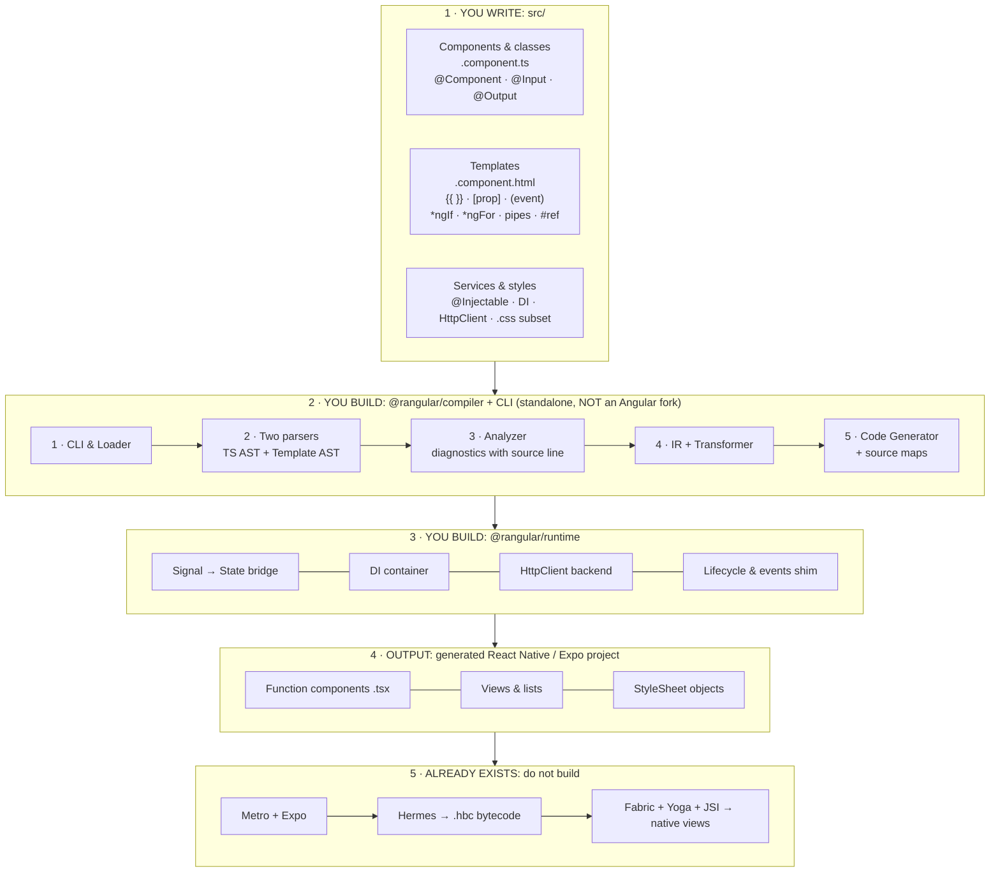

# Rangular framework

**Write Angular code, compile React Native code.**

The Rangular framework is a standalone transpiler: you write Angular-style code, TypeScript
classes with `@Component`, HTML-like templates, dependency injection, and
Rangular compiles it to React Native `.tsx`. The transpiler's target is React
Native JavaScript/JSX; **Hermes compiles that JavaScript to bytecode itself**,
so Rangular never emits bytecode, never forks Angular, and never parses
TypeScript by hand (it uses the official TypeScript compiler API).

Polish is a system, not luck: simple blocks compile to pre-polished
**Rangular Material** primitives driven by design tokens, see
[docs/UI_POLISH.md](docs/UI_POLISH.md). The full architecture is in
[docs/BLOCK_DIAGRAM.md](docs/BLOCK_DIAGRAM.md).

## Design principle: the preview is a promise

Any code that is successful as a mobile responsive must be successful
as an app. If compiled code renders and behaves correctly at phone
width in the preview, the same generated code must work as a real
React Native app. The preview never succeeds on something the app
cannot do: anything the app cannot do surfaces as a compiler
diagnostic, never as a preview-only success. A parity guard test scans
every example's generated `.tsx` and fails if a web-only API, a web
tag, or an out-of-subset style property leaks into generated code.

## Install and your first app

The Rangular framework is installed and used the Angular way: install the CLI once,
create an app with one command, then serve it and watch it run. Expo
Go on your phone plays the browser's role.

```sh
# 1. Install the CLI, once (Angular: npm install -g @angular/cli)
npm install -g @rangular/cli

# 2. Create the app (Angular: ng new my-app). The name is the
#    argument; the command creates the folder and installs the
#    app's dependencies itself. A starter Hello World is inside.
rangular new my-habit-app

# 3. Go into the app
cd my-habit-app

# 4. Serve it (Angular: ng serve). Scan the QR code with Expo Go;
#    saving a file recompiles and refreshes the phone.
rangular serve
```

Then open `src/app.component.html`, change the greeting, save, and
watch the phone update. The full guide, including the project naming
rules and how to rename an app later, is in
[INSTALLATION.md](INSTALLATION.md). One status note: the packages are
not on npm yet, so until the first publish the same journey runs from
a clone, as the Status today section of INSTALLATION.md spells out.

## Install and run

Prerequisites: **Node.js 20+ and npm** (the compiler itself has exactly
two dependencies: `typescript` and `@types/node`).

```sh
git clone https://github.com/bigyanchap/rangular.git
cd rangular
npm install
npm test          # builds with tsc, then runs the whole test suite
```

`npm test` also builds the compiler into `dist/`. Then try the examples:

```sh
# Compile the hello example (Angular -> React Native TSX)
node dist/packages/cli/src/cli.js build examples/hello/hello.component.ts --out examples/hello/hello.component.tsx

# Print a template AST (M0)
node dist/packages/cli/src/cli.js ast examples/hello/hello.component.html

# Render the dev preview used for visual eye-checks
node dist/packages/cli/src/cli.js preview examples/hello/hello.component.ts --out examples/hello/preview.html
```

Open `examples/hello/preview.html` in a browser: it is a working preview
of the compiled screen, and it is interactive: buttons run the
component's real translated methods, `*ngIf` / `*ngFor` respond to state,
child components render and emit, services are shared live. The committed
`examples/hello/hello.component.tsx` and `examples/hello/preview.html`
are the golden outputs of the commands above; the golden-file tests keep
them honest.

## Make an app

With the compiler built (`npm install && npm test` in the clone),
scaffold a real Expo app:

```sh
node dist/packages/cli/src/cli.js init my-app --app
cd apps/my-app
npm install
npx expo start
```

Scan the QR code with Expo Go. A bare name creates the app in the
checkout's `apps/` folder; an explicit path (`init ../my-app --app`)
is used as given. The app depends on `@rangular/ui` and
`@rangular/runtime` through `file:` specifiers pointing at this
checkout, carries the Expo SDK 58 pin set, and its starter component
(`src/app.component.ts`) is already compiled into `src/AppRoot.tsx`
by the real compiler. Edit the component, recompile it with
`rangular build` as the app README spells out, and Expo reloads.

What the scaffold installs for you, in full: the created app's
`package.json` carries `@rangular/ui` and `@rangular/runtime`
(through `file:` specifiers to this checkout), `expo ~58.0.0`,
`react 19.3.0`, `react-native 0.88.1`, `react-native-svg 15.16.0`,
`expo-image-picker ~58.0.10` and `expo-document-picker ~58.0.5`,
with `@babel/core`, `babel-preset-expo ~58.0.0` and
`typescript ~5.9.2` as dev dependencies. You install nothing else
by hand. If you ever copy `@rangular/ui` into an existing app
yourself instead of scaffolding, add `react-native-svg` and both
picker packages to that app yourself: the UI primitives name them
in `require` calls, and Metro resolves every such call when the
app bundles, so the bundle fails without them.

Two honest notes. The scaffold's structure and compilation are
covered by the test suite; an actual Expo Go launch on a device was
not run in the environment that built the scaffold, so your first
`npx expo start` is the device proof. And with routing, in-app
navigation is complete, but the Android hardware back button is not
wired to the Rangular navigator in this version: the compiled root
module keeps its navigator private, so nothing outside it can call
`back()` honestly, and the scaffold does not pretend otherwise.

## Block diagram



## Stage status

| Milestone | Scope | Status |
|---|---|---|
| M0 | Template AST + AST printer | ✅ Done (Stage 0+1) |
| M1 | Static component transpiles | ✅ Done (Stage 0+1) |
| M2 | Interpolation `{{ }}` + `[prop]` binding | ✅ Done (Stage 0+1) |
| M3 | Events + state (counter) | ✅ Done (Stage 2) |
| M4 | `*ngIf` / `*ngFor` | ✅ Done (Stage 2) |
| - | **Stage 2.5: Vibe layer**, `AGENTS.md`, `llms.txt`, generated catalog, recipe cards, `--json` diagnostics with `fix:` lines, delta tables | ✅ Done |
| M5 | Child components, `@Input` / `@Output` | ✅ Done (Stage 3) |
| M6 | Injected service + lifecycle + HttpClient | ✅ Done (Stage 3) |
| - | **Stage 4: Polish lock-in** - complete token set (light + dark), themed primitives, CSS snapping (`STYLE_OFF_SCALE`), preview Light/Dark toggle, showcase example | ✅ Done |
| M7 | CLI, source maps, error messages, Awaken Me dogfood | ✅ Done (Stage 5) |
| - | **Stage 6: Controls**, Material style switch, checkbox, segmented page switcher and radio group, settings example | ✅ Done |
| - | **Stage 7: Icons**, one `<icon>` block over a curated set of 27 Material style icons, compile time name validation, icons example | ✅ Done |
| - | **Stage 8: Forms**, the `<input>` block (`RgInput`), `[(ngModel)]` two-way binding with attribute validators and template refs, a lightweight `<form (submit)>` element, reactive `FormGroup` / `FormControl` / `Validators`, signup-form and profile-form examples | ✅ Done |
| - | **Stage 9: Routing**, a `Routes` array in `app.routes.ts` (or `--routes`), `<router-outlet>` in the root component, `routerLink` in string and array forms, `ActivatedRoute` params (`snapshot` + `paramMap`), `Router.navigate` / `navigateByUrl`, runtime `RgNavigator` + `matchRoute`, mini-mail example | ✅ Done |
| - | **Stage 10: Pickers and overlays**, an iOS wheel `<datetime-picker>` (date, time and datetime modes), declarative `<sheet>` and `<dialog>` blocks with an `<actions>` row, a built-in `SnackBar` service with `onAction` refs, the event assignment guard, reminder example | ✅ Done |
| - | **Stage 11: Data display**, `<tabs>` with content-owning `<tab>` children, single-open `<accordion>` with self-managed `<panel>` blocks, `<table>` with `<column name>` declarations, autocomplete on `<input>` (`[options]` + `(optionSelected)`), `<slider>`, `<progress-bar>`, `<spinner>`, `<chips>` / `<chip>`, and `badge` as an attribute on button, row and icon, mailbox-pro example | ✅ Done |
| - | **Stage 12: Language completeness and app readiness**, the full built-in pipe set plus custom `@Pipe` classes, attribute directives (style subset), content projection (single slot), the `rangular init --app` Expo scaffold, and the closing security re-audit, pipes-demo, directives-demo and projection-demo examples | ✅ Done |

## Packages

| Package | What it is |
|---|---|
| `@rangular/compiler` | Template parser + expression (Pratt) parser, `@Component` extractor (TypeScript compiler API), CSS-subset parser, RN code generator, HTML preview renderer |
| `@rangular/runtime` | Pure-TypeScript helpers for generated apps: `EventEmitter`, `signal()`, DI `Container`, `ReactiveService` (service reactivity base), `HttpClient` (Observable-lite over fetch), `pipe()`, forms classes (`Validators`, `validateValue`, `FormControl`, `FormGroup`), routing classes (`RgNavigator`, `matchRoute`, `Router`, `ActivatedRoute`), snackbar service (`SnackBar`, `SnackBarRef`) |
| `@rangular/ui` | Rangular Material: `tokens.ts` (pure TS), `icons.ts` (the curated icon set as SVG path data), `datetime.ts` (the picker's value model and wheel specifications, pure TS) + shipped-source RN primitives (`RgScreen`, `RgAppbar`, `RgCard`, `RgButton`, `RgText`, `RgList`, `RgRow`, `RgFab`, `RgSwitch`, `RgCheckbox`, `RgSwitcher`, `RgOption`, `RgRadioGroup`, `RgRadio`, `RgIcon`, `RgInput`, `RgOutlet`, `RgSheet`, `RgDialog`, `RgActions`, `RgSnackbar`, `RgDateTimePicker`, `RgTabs`, `RgTab`, `RgAccordion`, `RgPanel`, `RgTable`, `RgColumn`, `RgSlider`, `RgProgressBar`, `RgSpinner`, `RgChips`, `RgChip`) |
| `@rangular/cli` | `rangular build`, `rangular ast`, `rangular preview`, `rangular catalog`, `rangular watch`, `rangular init`, `rangular doctor` (build/preview/doctor accept `--json`; build accepts `--source-map`) |

> Note: `@rangular/ui` primitives and other shipped-source files for generated
> apps are **source shipped into generated projects**; they are not typechecked
> by this repo's build, because react-native types are not a dependency here.
> The compiler, CLI, runtime helpers, UI tokens and all tests *are* built and
> tested by the root build.

## Docs

- [docs/PINPOINT_MAP.md](docs/PINPOINT_MAP.md), the design map: the goal
  stated precisely, the finished thing in blocks, and where the work is.
- [docs/LEARNING_LIST.md](docs/LEARNING_LIST.md), the exact 77 things to
  learn to build Rangular (groups A-H), and nothing more.
- [docs/BLOCK_DIAGRAM.md](docs/BLOCK_DIAGRAM.md), the architecture in
  five layers, with the Mermaid diagram (also inline above).
- [docs/UI_POLISH.md](docs/UI_POLISH.md), how generated UI stays
  polished: tokens only, pre-polished primitives, compiler defaults,
  visual proof.
- [docs/VIBE_CODING.md](docs/VIBE_CODING.md), the AI-facing layer plus
  the full delta tables (Rangular vs Angular, Rangular vs React).
- [docs/ROADMAP.md](docs/ROADMAP.md), the approved plan for Stages 6
  to 12, each stage grounded in the Angular feature it mirrors.
- [SECURITY.md](SECURITY.md), the security audit: what was tested,
  what was found and fixed, and the project root boundary rule for
  files the compiler reads.

All documentation is Markdown on purpose: GitHub renders the Mermaid
diagrams natively, diffs and search work, and AI tools read it directly.
Markdown is the canonical format. There are no PDF copies to drift.

## Vibe-coding ready

Rangular is built to be written by AI assistants (and humans working
through them) **without guessing**, see [docs/VIBE_CODING.md](docs/VIBE_CODING.md):

- **[AGENTS.md](AGENTS.md)**, the rules of this repo: never edit generated
  files; every capability ships with compiler support + tests + a tiny
  example + a recipe card + a regenerated catalog.
- **[llms.txt](llms.txt)**, one AI-readable index of every doc, example
  and package, including the 6-step "how to build a screen" loop.
- **[catalog.md](catalog.md) / `catalog.json`**, every tag, event,
  primitive prop, token scale and diagnostic code, **generated from the
  code** by `rangular catalog` (a test fails if the committed catalog is stale):

  ```sh
  node dist/packages/cli/src/cli.js catalog --out .
  ```

- **Recipe cards**, `examples/hello/README.md`,
  `examples/counter/README.md`, `examples/inbox/README.md`,
  `examples/profile/README.md`, `examples/favourite/README.md`,
  `examples/shared-inbox/README.md`, `examples/showcase/README.md`,
  `examples/dinacharya-row/README.md`, `examples/settings/README.md`,
  `examples/icons/README.md`, `examples/signup-form/README.md`,
  `examples/profile-form/README.md`, `examples/mini-mail/README.md`,
  `examples/reminder/README.md`, `examples/mailbox-pro/README.md`,
  `examples/pipes-demo/README.md`,
  `examples/directives-demo/README.md`,
  `examples/projection-demo/README.md`: Intent /
  Source / What it compiles to / Rules used / Common mistakes.
- **Proof test (Stage 2.5)**, `examples/profile/` was written by a fresh
  AI agent given only AGENTS.md, llms.txt, the catalog and the recipe
  cards (no compiler source): it compiled with zero diagnostics on the
  first attempt, and every gap it reported was fixed in the docs
  (supported-expression list, avatar/row semantics, composition rules).
- **Machine-readable errors**, `rangular build --json` prints a single
  JSON object (`{ ok, outFile?, diagnostics[] }`) on stdout; every
  diagnostic carries a concrete `fix:` suggestion.
- **Delta tables**, [docs/VIBE_CODING.md](docs/VIBE_CODING.md) states
  exactly how Rangular source differs from Angular (what is the same,
  what is not supported yet, with stages) and from React (no JSX, no
  hooks in source; classes + HTML templates).

## Stage 2: events, state, `*ngIf` / `*ngFor`

Two more examples live beside `hello`, same CLI commands, same golden rule:

- `examples/counter/`, **M3.** A field assigned inside any method becomes
  React state (`count` → `const [count, setCount] = useState(0)`); fields
  never assigned stay plain `const`. Methods become const arrow functions,
  and `(click)` bindings become `onPress` props.
- `examples/inbox/`, **M4.** A `*ngFor` row over a literal `mails` array
  becomes a keyed `.map(...)`, and the `*ngIf` empty state becomes
  `{cond && (...)}`.

**Supported method-translation subset.** Method bodies are translated from
the TypeScript AST: `this.field` reads, assignments (`=`, `+=`, `-=`, `*=`,
`/=`), `this.field++` / `--`, `this.method(...)` calls, `$event` parameters,
expression statements, `return`, `if` / `else`, blocks, and local
`const`/`let` declarations. Anything else (loops, `try`, `switch`, …)
produces a `METHOD_UNSUPPORTED` warning and a `TODO` comment in the
generated code, it is never silently dropped and never emits broken
syntax. Field initializers composed of literals (including nested arrays
and objects) hoist to `const`/`useState`; other initializers keep the
warning + TODO behaviour.

**`else` in `*ngIf`** microsyntax is detected and reported
(`GEN_NGIF_ELSE_TODO`) with the element emitted unconditionally; full
else/then support is a later stage. `*ngFor` supports
`let item of items`, `let i = index`, and `trackBy: fnName`
(key = `fnName(item)`, otherwise `item?.id ?? i`).

**Interactive previews.** `rangular preview` now emits a *working* page for
Stage 2 components: literal fields become a JS `state` object, methods are
translated into functions that mutate it, and a small in-page runtime
(expression evaluator + DOM renderer over the serialized template AST)
re-renders on every `(click)`. `*ngIf` and `*ngFor` behave in the preview
as they will in React Native. The preview uses the compiler's own AST
expression evaluator (`packages/compiler/src/template/evaluate.ts`, with
built-in pipes `uppercase`, `lowercase`, `titlecase`, `json`), no
`eval`/`Function` on source text anywhere.

## Stage 3: child components, services, lifecycle, HttpClient

Two more examples, same CLI commands, same golden rule:

- `examples/favourite/`, **M5.** A parent screen renders three
  `<quote-card>` children with `*ngFor`; each child takes `@Input() quote`
  / `@Input() author` and has `@Output() favourited`. Tapping a child's
  Save button emits, and the parent's "Saved: N" appbar count goes up.
- `examples/shared-inbox/`, **M6.** A `MailService` holds the inbox;
  the parent screen (list + "Mark all read") and a child `<unread-badge>`
  inject the *same* instance, so one tap updates the list and the badge.
  The badge's `loaded` flag is set by `ngOnInit`.

**Child components (M5).** Resolution follows the entry component's
relative imports, transitively: an imported `@Component` class is a known
child, keyed by its `selector`. `@Input` fields become props, the
literal initializer is the default when the parent omits the binding,
and plain attributes pass strings. An `@Output` field initialised with
`new EventEmitter<T>()` becomes a callback prop named `on` + Capitalised
name; `this.saved.emit(x)` in the child compiles to `onSaved?.(x)`, and
the parent's `(saved)="handler($event)"` receives the emitted value as
`$event`. Import cycles are a `CMP_IMPORT_CYCLE` warning (classes on the
cycle still resolve); a duplicated selector is `CMP_DUP_SELECTOR`.

**Services and DI (M6).** `@Injectable({ providedIn: 'root' })` classes
compile to real classes extending the runtime's `ReactiveService`, in the
same generated file as the components. A module-level `__container`
holds one singleton per service (registrations dependency-ordered;
services may inject services); components resolve constructor parameter
properties from it, `constructor(private mail: MailService)` becomes
`const mail = __container.get<MailService>(MailService)` plus a
`useSyncExternalStore` subscription, so when a service method assigns a
field (the codegen appends `this.__notify()` after each assignment) every
subscribed component re-renders. An unknown token is a
`DI_UNKNOWN_TOKEN` error with a fix; a service dependency cycle is
`DI_CYCLE`. Mutating items in place without assigning a field does not
notify, reassign the field.

**Lifecycle.** `ngOnInit()` is called from `useEffect(..., [])` (once,
after first render) and `ngOnDestroy()` from that effect's cleanup. The
preview runs a component's `ngOnInit` once when its instance is created;
the static first paint shows pre-init state on purpose.

**HttpClient.** The runtime ships an `HttpClient` whose `get(url)`
returns an Observable-lite (`{ subscribe(next?, error?) }`) over `fetch`
(the fetch implementation is injectable, so tests never touch the
network). It is registered in the generated container and injected like
any service. The supported component-side shape is exactly
`this.http.get(url).subscribe((data) => { this.field = data; });`,
block-bodied arrow, assignments inside. An expression-bodied assignment
degrades to `METHOD_UNSUPPORTED` instead of emitting wrong code. In
previews, `HttpClient` is a stub whose `get()` never emits.

**One file out.** Services, child components and the entry component all
compile into the entry's single generated `.tsx`, that is what makes
the container a true singleton, and it keeps generated output trivially
deterministic. A template whose root is a structural directive (or has
several roots) is wrapped in a `<>...</>` fragment so the output stays
valid JSX.

## Stage 4: tokens, theming, and snapping

One more example:

- `examples/showcase/`, the token system on one screen: every text
  variant, a card, primary and disabled buttons, an avatar list, a
  badge, a FAB, and styles written entirely on the token scales. Its
  preview is the eye-check for this stage: flip the Light/Dark toggle
  in the preview chrome and the same screen renders from the dark
  token set.

**The token set is complete.** Colour roles (primary, onPrimary,
primaryContainer, onPrimaryContainer, secondary, surface,
surfaceVariant, onSurface, onSurfaceVariant, background, error,
onError, outline, scrim, and the rest) exist in light AND dark with
the same names; the spacing scale (4 to 32), radius scale (8 to 20
plus full), type scale (caption 12 to display 32, each step with a
fixed line height and weight) and three elevation presets sit beside
them. The original role names keep working as aliases: `text` is
`onSurface`, `textMuted` is `onSurfaceVariant`, `danger` is `error`.
`themes.light` and `themes.dark` export both modes as objects.

**Theming.** Primitives take every colour from the active theme, and
not one hex value is hard-coded in `primitives.tsx` (a test greps for
hex and fails the build). The theme travels through a React context
(`RgThemeProvider` / `useRgTheme` in `@rangular/ui`, default light).
Writing `<screen theme="dark">` compiles to `<RgScreen theme="dark">`
and themes that whole subtree. In previews, colours resolve through
CSS variables, the declared theme is the starting palette, and the
chrome toggle swaps the palette without changing a single node.

**Snapping.** Component `styles` resolve to the scales at compile
time: spacing properties (margin, padding, gap, top/left/right/
bottom), `border-radius` and `font-size` snap to the nearest scale
value. An off-scale value compiles with the snapped value and earns a
`STYLE_OFF_SCALE` warning whose fix names it (`margin-bottom: 13px`
becomes 12). On-scale values and 0 pass silently. Colours are never
snapped.

## Stage 5: CLI completion, source maps, doctor, dogfood

The final v1 stage is about the working day around the compiler.

**The CLI, complete.** One line per command:

- `rangular build <component.ts> --out <file.tsx> [--json] [--source-map]`: compile one component to React Native TSX.
- `rangular ast <template.html>`: print a template AST (M0).
- `rangular preview <component.ts> --out <file.html> [--json]`: render the interactive dev preview.
- `rangular catalog [--out <dir>]`: regenerate `catalog.json` and `catalog.md` from the code.
- `rangular watch <component.ts> --out <file.tsx>`: compile now, then recompile on every change to the component, its template, or its imports (the watch set re-resolves after each compile). Prints a timestamped OK or the diagnostics; Ctrl+C stops it cleanly.
- `rangular init <dir>`: scaffold a starter project (a welcome screen in `src/`, a README, a `.gitignore`). Refuses a non-empty directory.
- `rangular doctor <component.ts> [--json]`: the polish linter, below.

**Per-file diagnostics.** Diagnostics now carry the file they belong
to: template problems name the `.html` file, class problems the `.ts`
file, style problems the file holding the styles. The JSON output
includes `file` per diagnostic (the top level `file` still names the
entry component), and human output prints the file whenever it differs
from the entry file.

**Source maps, honestly scoped.** `rangular build --source-map` also
writes `<out>.map`, a source map v3, and appends the
`//# sourceMappingURL=` comment to the generated file (only with the
flag, so default output is unchanged). Granularity in v1 is block
level, not per expression: the generated component function start maps
to the class declaration, and each top level template element's
generated JSX start maps to that element's line and column in the
template file.

**Doctor.** `rangular doctor` reports polish findings as diagnostics
with `DOC_` codes, each with source file, line and a fix: `DOC_HEX_COLOR`
(a hex colour literal in styles instead of a colour role),
`DOC_OFF_SCALE` (a value the compiler would snap, reported without
changing anything), `DOC_RAW_TEXT` (loose text directly inside
`screen`, `card` or `list` instead of a text element), and
`DOC_TAP_TARGET` (a `(click)` element sized below 44 by 44, the one
error-severity rule). Exit code is 1 only when an error finding
exists; warnings alone exit 0. One escape exists on purpose: a CSS
comment containing `doctor: allow-hex` in a style text disables the
hex check for that file's styles, for deliberate brand colours (the
dogfood example's Awaken Me gold is the case in point).

**Visual goldens, in snapshot form.** There is no device screenshot
pipeline in this repo yet, so each example carries a
`styles.snapshot.json`: the preview's resolved key styles per element
role for both themes, plus the example's own parsed component styles,
all derived from the same token data the preview renders from. A test
regenerates every snapshot and fails on drift that was not
deliberately approved by updating the snapshot. Structural and style
goldens stand in for screenshot goldens until a device pipeline
exists.

**Dogfood.** `examples/dinacharya-row/` models one real Awaken Me
Dinacharya block row: the 34 by 34 check square (flat gold `#d9a441`
with a check mark when done, bronze outline when not), the title, the
time range, and the quiet pieces line ("3 pieces, 2 done"). Tapping
the featured row toggles it, in the preview and in the generated code.
Its recipe card states plainly what matches the real app and what is
simplified.

## Stage 6: controls

One more example:

- `examples/settings/`, a settings screen using all four new
  controls against real state: a Wi-Fi switch, a Notifications
  checkbox, a List and Statistics switcher that swaps the panel
  below it with `*ngIf`, and a radio group for text size.

**The controls set.** Four blocks mirror the Angular Material
components Angular applications already use: `switch` mirrors
`mat-slide-toggle`, `checkbox` mirrors `mat-checkbox`, `switcher`
mirrors `mat-button-toggle-group`, and `radio-group` mirrors
`mat-radio-group`. Each takes a bound value (`[checked]` or
`[value]`) and emits the next value through `(change)` as `$event`;
a component method receives the value and assigns it to the field,
so templates never contain assignment expressions. `switch` also
accepts `[disabled]`.

**Declaration children.** A switcher contains only `option`
elements and a radio group contains only `radio` elements. The
generated `RgOption` and `RgRadio` elements stay inside their
group, and the group primitive reads each child's `value` and
label, the way a select element reads its options. Wrong nesting
earns a `GEN_CONTROL_NESTING` warning with a fix line.

**The switcher is view state, not routing.** It changes a field on
the same screen; real navigation between screens is routing
(Stage 9, below).

**Switch motion.** The knob only ever moves toward its target:
the React Native primitive uses a plain linear timing move, never
a spring, so it cannot overshoot or bounce back, and the preview
uses a linear CSS transition between the same two end states.

## Stage 7: icons

One more example:

- `examples/icons/`, the full icon set with a name label under each
  icon (drawn inside a `*ngFor`), plus a usage strip: a bell in the
  primary colour role, a small search icon, a large heart in the
  error role.

**Icons.** `<icon name="search">` draws one of 27 curated Material
style icons, stored as SVG path data in `packages/ui/src/icons.ts`.
`size` is 20, 24 or 28 (default 24) and `color` names a theme colour
role; with no color the icon takes the theme text colour. The
generated app draws the paths through `RgIcon` with
react-native-svg (it ships inside Expo Go and standard Expo and
React Native projects), and the preview draws the exact same path
data as inline SVG, so the two cannot drift apart. The appbar menu
and the checkbox tick are set icons now, not font characters.

**Validation.** A name outside the set is a `GEN_ICON_UNKNOWN`
error at compile time: the fix points at the Icons list in
catalog.md, and the JSON diagnostic carries the whole valid list in
a `validIcons` field. A missing name is `GEN_ICON_NAME`. An
off-scale size warns (`GEN_ICON_SIZE`) and snaps to the nearest
on-scale size, the same rule styles use. Custom project icons are
not in this stage; they are planned as a register-your-own path set.

## Stage 8: forms, the Angular way

Two more examples:

- `examples/signup-form/`, a create account form the
  template-driven way: `[(ngModel)]`, attribute validators,
  `#name="ngModel"` refs, error lines, submit gating.
- `examples/profile-form/`, a profile form the reactive way: a
  `FormGroup` built in the class, `[formGroup]` and
  `formControlName`, errors through `profileForm.get('email')`.

**The input block.** `<input>` compiles to `RgInput`, a Material
style field: label above the field, an outlined box from the
tokens, placeholder, an error line under the field, a disabled
state. `type="password"` is a secure entry, `type="email"` and
`type="number"` pick the keyboard. `(input)` and `(change)` deliver
the text as `$event`; `(blur)` maps to `onBlur`.

**Template-driven forms.** `[(ngModel)]="email"` on an `<input>`
is a real two-way binding: the value in, a write back through the
field's state setter out. The `[ngModel]` plus `(ngModelChange)`
pair works too. Validators are attributes (`required`,
`minlength`, `maxlength`, `email`, `pattern`) checked by the
runtime `Validators`, with Angular's error shapes; `type="email"`
alone does not validate, exactly as in Angular. A
`#email="ngModel"` ref exposes `valid`, `invalid`, `touched` and
`errors` to template expressions, so
`<p *ngIf="email.invalid && email.touched">` and a submit button
gated by `[disabled]="email.invalid"` just work. ngModel on any
other element is a `GEN_NGMODEL_TARGET` error: the Stage 6
controls already have their `(change)` contract.

**The form element.** `<form (submit)="save()">` wraps the fields;
a `<button type="submit">` inside runs the handler after marking
every ngModel input touched, so errors appear on save. There is no
NgForm object and no form-wide validity for template-driven forms;
gate with the refs.

**Reactive forms.** `FormGroup`, `FormControl` and `Validators`
imported from `@angular/forms` are runtime classes. A group field
is a stable instance held in a ref in the generated code; control
changes re-render through a version counter subscribed to each
control's `valueChanges`. `formControlName` binds a control of the
enclosing `[formGroup]` form, an unknown name is a compile error
naming the real controls, and handlers read
`this.profileForm.value` directly. The preview builds the same
group from the field initializer with a small evaluator (literal
values, `Validators` references and calls, validator arrays); a
richer initializer warns `GEN_FORM_INITIALIZER` and still compiles
for the app. Group-level validators, `FormArray` and async
validators are not in this stage. The full boundary list is the
Forms section of [docs/VIBE_CODING.md](docs/VIBE_CODING.md).

## Stage 9: routing

Angular apps navigate with a route table, an outlet and links;
Rangular source now does the same, in the modern standalone form.
The routes live in `app.routes.ts` next to the root component (or
in the file named by `rangular build --routes <file>`), as the
`export const routes: Routes = [...]` array that `provideRouter`
consumes in current Angular, not the historical
`RouterModule.forRoot` module form:

```ts
export const routes: Routes = [
  { path: '', redirectTo: 'inbox', pathMatch: 'full' },
  { path: 'inbox', component: InboxComponent },
  { path: 'mail/:id', component: MailDetailComponent },
  { path: '**', component: NotFoundComponent },
];
```

The root component hosts one `<router-outlet>`; the generated app
builds a runtime `RgNavigator` (a stack of matched entries) from
the table, mirrors its current entry in state, and renders the
matched route component inside the `RgOutlet` primitive. Route
components are ordinary components imported by the routes file.
`routerLink="/inbox"` and `[routerLink]="['/mail', m.id]"` on a
`<button>` or `<row>` compile to a navigation press (array literals
joined the expression subset for the array form). A detail screen
injects `ActivatedRoute` and reads `route.snapshot.params.id` (a
string, always) or subscribes to `route.paramMap`; a method
navigates with `this.router.navigate(['/inbox'])` or
`navigateByUrl`. Matching is one runtime function: declaration
order, one-segment `:param` capture, full-match redirects (chains
resolve, loops fail closed), `**` catches the rest.

Boundaries, stated plainly: same-component parameter changes
remount the component in v1 (Angular reuses it and pushes the new
value through `paramMap`); navigation commands resolve from the
root; there are no child routes, guards, resolvers, lazy loading
or `routerLinkActive` yet, and a route entry using one is a
`GEN_ROUTE_UNSUPPORTED` error naming the feature. No routes file
while routing is used is `GEN_ROUTES_MISSING`; an unknown
component class is `GEN_ROUTE_COMPONENT`; a repeated path warns
`GEN_ROUTE_DUPLICATE`. The preview runs the whole flow and shows a
dashed "Preview navigation" Back bar at depth 2 or more: preview
chrome only, standing in for the phone's back affordance
(`RgNavigator.back()` is the app-side API; the Stage 12 Expo
scaffold states the hardware button boundary plainly, see
Make an app below). The
[mini-mail example](examples/mini-mail/) proves it end to end:
shell, inbox, a `mail/:id` detail reading its param over the
shared MailService, and a wildcard page reached through a
deliberately stale link. The full boundary list is the Routing
section of [docs/VIBE_CODING.md](docs/VIBE_CODING.md).

## Stage 10: pickers and overlays

**The date-time picker is the iOS wheel picker on every platform.**
That is a product rule, not a styling preference: no calendar
grid, no Android style date or time dialog. A
`<datetime-picker label="When" mode="datetime" [value]="when"
(change)="onWhen($event)">` field shows the formatted value;
tapping it opens a bottom sheet with wheels (date mode: month,
day, year; time mode: hour 1 to 12, minute, AM/PM; datetime mode:
one combined date wheel plus hour, minute and AM/PM). Done and
Cancel sit in the sheet header as accent text buttons: Done emits
the composed ISO string through `(change)`, Cancel discards.
`minuteInterval` is 1 or 5 and anything else warns and snaps
(`GEN_PICKER_INTERVAL`); an unknown mode is a `GEN_PICKER_MODE`
error. The value model (ISO parsing, leap correct months, wheel
specifications) lives in `@rangular/ui` `datetime.ts`, shared by
the primitive and parity-tested against the preview mirrors.

Angular Material opens its overlays from services; Rangular v1
makes the same surfaces declarative, because its templates are
declarative. `<sheet [open]="sheetOpen" (close)="closeSheet()">`
is MatBottomSheet as a block: children render inside a themed
panel that slides up over a dimmed backdrop, and a backdrop tap
emits `(close)`. `<dialog [open]="confirmOpen"
(close)="closeConfirm()" title="Delete this reminder?">` is
MatDialog the same way, a centred card whose buttons usually sit
in an `<actions>` row. Without `[open]` an overlay renders
statically and warns `GEN_OVERLAY_OPEN`. Stage 10 also settled a
repo wide rule from the code: template event bindings never hold
assignments, because the expression grammar has no assignment
operator. `(close)="sheetOpen = false"` warns
`GEN_EVENT_ASSIGNMENT` and is dropped; the pattern is a method
that assigns inside the class.

The snack bar keeps the Material service shape: inject the
built-in `SnackBar` in a component and call
`this.snack.open('Reminder saved')` or
`open(message, actionLabel, durationMs)` (4000 ms by default).
`open` returns a ref; the supported action form is the statement
form, `const ref = this.snack.open('Reminder deleted', 'Undo');`
followed by `ref.onAction(() => { ... });` with a block body,
which the method translator carries honestly. The generated root
renders the `RgSnackbar` host while a bar is open, opening a bar
replaces the current one, and pressing the action dismisses the
bar and then fires the callbacks. The
[reminder example](examples/reminder/) proves all four pieces
together: a form with the picker, a sheet holding a repeat radio
group, a confirm dialog, and Undo on the deleted snackbar. The
full boundary list is the Pickers and overlays section of
[docs/VIBE_CODING.md](docs/VIBE_CODING.md).

## Stage 11: data display

Seven components, all in the Stage 6 declaration pattern: a group
primitive reads its declaration children, and the children render
nothing alone. **Tabs** follow the controls contract:
`<tabs [index]="tabIndex" (change)="onTab($event)">` with
`<tab label="Inbox">` children whose template children are real
content, rendered only while the tab is selected. That is the
difference from the Stage 6 switcher, which is a bare control
emitting a value and owns no panels. **Expansion panels** manage
their own open state: `<panel title="Storage" subtitle="...">`
toggles on a header tap, `[expanded]` seeds the starting state,
and `(toggle)` emits the next boolean. Wrapped in `<accordion>`,
direct panels coordinate single-open, like mat-accordion with
`multi` false. **Tables** compress mat-table to
`<table [data]="folders">` with `<column name="count"
header="Messages">` declarations: the name (Material's
matColumnDef name; `key` is an alias, because React reserves
`key`) reads that property of each row object. No column
templates in this version (sorting and pagination arrived in
Stage 14), and empty data
shows nothing unless the table carries `emptyText`.

**Autocomplete** is an `<input>` with `[options]` bound to a
string array and `(optionSelected)`: while focused, options
containing the typed text (case-insensitive substring, the
Material example filter) list under the field, and a pick writes
back through ngModel and emits the chosen string. **Slider**
takes taps and drags, snapping to `step` and clamping to
`min`/`max`, emitting on release. **Progress** is a determinate
`<progress-bar>` (out of range values clamp, with a warning when
statically known) plus `mode="indeterminate"`, and a `<spinner>`
rotating one SVG arc whose size rides the icon scale. **Chips**
are label pills in a `<chips>` row, with an optional leading icon
and a `removable` close control firing `(remove)`; removing one
from a list is a filter assignment in a method, which the method
translator carries. **Badge** is matBadge as an attribute:
`badge="3"` or `[badge]="unread"` on `<button>`, `<row>` and
`<icon>` only, an error coloured count dot that hides at 0 and
caps at `99+`. The [mailbox-pro example](examples/mailbox-pro/)
exercises all seven on one screen. The full boundary list is the
Data display section of [docs/VIBE_CODING.md](docs/VIBE_CODING.md).

## Stage 12: language completeness and app readiness

**Pipes are complete.** The built-in set is `uppercase`, `lowercase`,
`titlecase`, `json`, `date` (named formats `shortDate`, `mediumDate`,
`shortTime`, `medium`, `short`, or a custom token string), `number`
and `percent` (with digitsInfo like `'1.2-2'`), `currency` (USD, EUR,
GBP, INR and NPR symbols; an unknown code prints itself), `slice`
(strings and arrays, negative indexes included), `keyvalue` (an
object to `{ key, value }` entries sorted by key, built for
`*ngFor`), and `async`. One table of cases runs through the
compiler's evaluator, the generated code's runtime `pipe()` and the
preview page, and all three agree, leap dates and rounding included.
**Custom pipes** are `@Pipe` classes the component imports like a
child or a service: `transform` compiles onto a plain class with one
shared instance, and an unregistered name is a `PIPE_UNKNOWN` error
listing every known pipe. The **async pipe** subscribes for real:
generated code gives each distinct streamed expression a state slot
and an effect that unsubscribes on unmount (the expression is
captured at mount, so stream a stable field or service property),
and the preview page keeps one subscription per observable and
re-renders on emission.

**Attribute directives** ship as the canonical beginner shape: the
HighlightDirective pattern (`@Input()` fields, an injected
`ElementRef`, styling logic in `ngOnInit` or a setter) whose body is
only `this.el.nativeElement.style.<prop> = <expr>` assignments. The
compiler folds those into the host element's style at compile time,
in generated code and in the preview; anything richer warns
`DIR_UNSUPPORTED` with the offending statement quoted. **Content
projection** is the single default slot: `<ng-content>` in a child
compiles to the React `children` prop, projected content keeps the
parent's scope, and a `select` attribute warns
`PROJECTION_SELECT_UNSUPPORTED` and behaves as the default slot.
The [pipes-demo](examples/pipes-demo/),
[directives-demo](examples/directives-demo/) and
[projection-demo](examples/projection-demo/) examples prove each
piece in generated code and in the interactive preview.

**App readiness** is the `init --app` scaffold above, verified
structurally and by compilation in the test suite. The **closing
security re-audit** re-ran the Stage 5 adversarial method over the
Stage 6 to 12 surface: one High found and fixed (a static
`minlength` / `maxlength` attribute was emitted raw into the
generated validators call and could inject code; static validator
arguments are now digits-only data, with `GEN_VALIDATOR_ARG` for
anything else), and icon names, routerLink strings, routes file
contents, pattern attributes, datetime values, autocomplete options,
badge values, custom pipe names, projection children and scaffold
paths each fixture-tested clean. The full record is in
[SECURITY.md](SECURITY.md). The exact limits of everything in this
stage are the Pipes, Attribute directives, Content projection and
Expo app scaffold sections of [docs/VIBE_CODING.md](docs/VIBE_CODING.md).

## Stage 14: the missing Material pieces

An audit against the Angular Material component list (2026-11-13)
found ten pieces missing. They are built now, each with compiler
support, tests, an example and a recipe card, in two tour examples:
`examples/app-shell/` (drawer, menu, stepper, divider) and
`examples/explorer/` (select, tree, grid list, sortable paged
table, tooltip).

**Menu** is an overlay with the sheet contract:
`<menu [open]="menuOpen" (close)="closeMenu()">` holds
`<menu-item icon="edit" (click)="rename()">Rename</menu-item>`
rows (and `<divider>` between them); choosing an item runs its
handler and closes the menu. **Drawer** (MatSidenav, over mode) is
the same contract with a full height panel from the left.
**Select** (MatSelect) is a control: `[value]` in, `(change)` out,
`<option>` declarations, and a bottom sheet of choices with a
check on the current one. **Stepper** (MatStepper) follows the
tabs contract, `[index]` and `(change)`, each `<step label="...">`
owning its page, completed steps carrying a check. **Grid list**
lays `<grid-tile>` children out in `cols` columns. **Tree** nodes
nest `<tree-node label="...">` inside each other and manage their
own expansion, `expanded` as the seed. **Divider** is one
hairline. **Tooltip** is an attribute on button, row and
icon-button, shown on long press (the mobile form of matTooltip);
anywhere else the compiler warns `GEN_TOOLTIP_HOST` and drops it.
And the **table** grew its two missing pieces: a `sortable`
column whose header cycles ascending, descending, unsorted, and a
`pageSize` that pages the rows with a range and chevron pager.
One compiler bug was found and fixed on the way: `(change)`
handlers on the new controls generated an arrow that referenced
`$event` without receiving it; select and stepper now sit in the
same control list as switch, checkbox, switcher, radio group and
tabs, with a regression test.

## Stage 15: beyond Angular

Version 0.1.2. The stage itself shipped as 0.1.1; 0.1.2 marks the
file picker dependency fix that on-device testing found the same
day (both Expo picker packages are required dependencies, and the
scaffold now writes them into every new app). A second audit (2026-11-13) listed the pieces real
apps use constantly that Angular itself, core, Material and CDK
together, never shipped, and that Rangular also lacked: twenty
items in three tiers, all built in this stage, each with compiler
support, preview parity in both renderers, tests, an example and a
recipe card. The tour examples are `examples/feed/` (Tier 1),
`examples/forms-plus/` (Tier 2) and `examples/insights/` (Tier 3).

Tier 1, screen and list patterns. **Bottom navigation**,
`<bottom-nav [index] (change)>` of `<nav-item icon label>`
destinations with `routerLink`, `(click)` and `badge` support; the
screen pins it under the scrolling content. **Pull to refresh**:
`[refreshing]`, `(refresh)` and `(endReached)` on `<screen>` and
`<list>`, wired to React Native's RefreshControl and the FlatList
end callback in the app; the preview shows a spinner row for the
flag and documented tap cues for the two events, the slider tick
pattern. **Skeleton** placeholders (`shape` line, block or circle)
pulse inside any container. **Swipe actions** are
`<row-action icon color (click)>` declarations inside a row,
revealed by a gesture in the app and a handle in the preview.

Tier 2, controls on the Stage 6 contract. The **file and image
picker** emits `{ name, uri, size, type }` arrays through
`(change)`; both expo-image-picker and expo-document-picker are
required dependencies of any app using `@rangular/ui`, because
Metro resolves the picker's literal requires when the app bundles
(the scaffold writes both into the app's `package.json`, and Expo
Go carries both), stated plainly in its recipe card. The **input
mask** is a `mask` attribute on `<input>` with a three character
pattern language (`9` digit, `A` letter, `*` any); the masked
string is the model value. **Rating** is a number in and out with
icon set stars. **OTP** is one control, one digit string, `length`
4 to 8. **Carousel** pages its projected children on the stepper's
index contract.

Tier 3, display. **Timeline** items on a rail, a **calendar** month
view as a screen element (not the wheel picker; `[value]` and
`(change)` carry an ISO day), **avatar** and **avatar-group** with
a +N overflow, **empty state**, **charts** (bar, line, pie over
`{ label, value }` points, one small geometry engine shared by the
app and both previews; scope: one series, no axes, no animation),
a **rich text editor** whose value is markdown style marked text
with a Bold, Italic and List toolbar (a marked-up text field with
helpers, not a WYSIWYG engine, stated plainly in its recipe card),
**image** (the catalog's first image tag; declared size is the
contract and the doctor enforces it) with a **lightbox** overlay,
**masonry** as a `mode` of grid-list (the same tags and tiles,
dealt into column stacks), a **colour picker** over a shared data
palette with a custom hex row, and **breadcrumbs** with chevron
icon separators. Two new diagnostics: `GEN_CHART_TYPE` (error) and
`GEN_OTP_LENGTH` (warning); declaration nesting covers the new
groups, and the badge gained a fourth host, the nav item. The
catalog now stands at 74 tags, 68 primitives and 62 diagnostic
codes.

## v1 is complete

What v1 is: an Angular-style component, template, service and DI
subset compiling to readable React Native TSX, with a Material token
system in light and dark, an interactive preview that behaves like the
app, machine-readable diagnostics with fixes, a full CLI, a runnable
Expo app scaffold, and a recipe card proving every capability on a
tiny example.

Deliberately post-v1: animations, the full RxJS surface (operators,
Subjects), multi-slot projection, `*ngIf` else/then, routing guards,
resolvers and lazy loading, hardware back wiring for the navigator,
per-expression source maps, device screenshot goldens, and following
the OS dark mode setting by default. The full sequence is in
[docs/ROADMAP.md](docs/ROADMAP.md).

## License

Rangular is free and open source, licensed under the Apache License
2.0, with copyright held by Bigyan Chapagain. Use it for anything,
including commercial apps of any size; the license also carries a
patent grant and does not grant rights to the Rangular name. The
full text is in [LICENSE](LICENSE).
