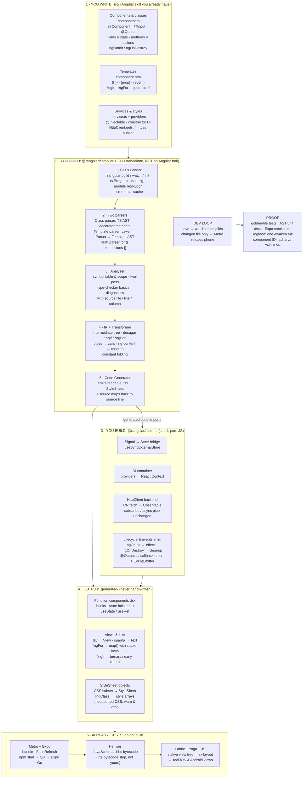

# Rangular: Block Diagram

**Angular code, transpiled to React Native.**
Prepared for Bigyan, 2026-11-12. Companion to `angular-to-react-native-pinpoint-map.md` and `rangular-learning-list.md` (the 77 things).

**The one line to remember:** Rangular's target is React Native JavaScript / JSX, never bytecode. Hermes makes the bytecode itself. You build only the middle; both ends already exist, and you already know both.

## The diagram

## Reading it, layer by layer

| Layer | What it is | Yours? |
|---|---|---|
| 1 · Source | Angular-style code: components, templates, services/DI, CSS subset | Write it, skill already yours |
| 2 · Compiler | CLI/loader → two parsers → analyzer → IR/transformer → code generator + source maps | **Build it, the whole project lives here** |
| 3 · Runtime | Tiny JS library every generated file imports: signal→state bridge, DI container, HttpClient-on-fetch backend, lifecycle/EventEmitter shims | Build it, small |
| 4 · Output | Generated React Native/Expo project in `.generated/`: function components, hooks, StyleSheet | Never hand-write; debug via source maps |
| 5 · RN toolchain | Metro bundling, Hermes bytecode (`.hbc`), Fabric/Yoga/JSI native rendering | Already exists, understand the picture only |

## Decisions already settled (from the 2026-11-12 discussion)

- **Do NOT fork Angular.** Giant Bazel monorepo; a fork burns effort on navigation and goes stale every release. Standalone transpiler using Angular's public pieces (TypeScript compiler API) instead.
- **Do NOT emit Hermes bytecode directly** and **do NOT write a TypeScript parser**, both are solved problems with zero user-visible gain.
- **HTTP:** Angular code is unchanged. Rangular registers a different HttpClient backend under the same DI token, built on React Native `fetch`, results wrapped as an Observable. No CORS on native; URLs must be absolute; cookies do not come free.
- **Dev loop:** `npm start` = Rangular compiler in watch mode (transpiling `src/` into the generated Expo project) + Metro. Scanning the QR in Expo Go runs it, because the runtime is pure JavaScript. A dev build is needed only if a library requiring custom native code is added.
- **Out of v1 scope:** full Angular compatibility (forms, animations, SSR, full RxJS surface), a routing library (map to React Navigation later).

## Build order (milestones)

M0 AST printer → M1 static component renders on phone → M2 interpolation + property binding → M3 counter (events + state) → M4 `*ngIf` / `*ngFor` → M5 child components, inputs/outputs → M6 injected service + lifecycle → M7 CLI, source maps, real error messages + Awaken Me dogfood demo.
